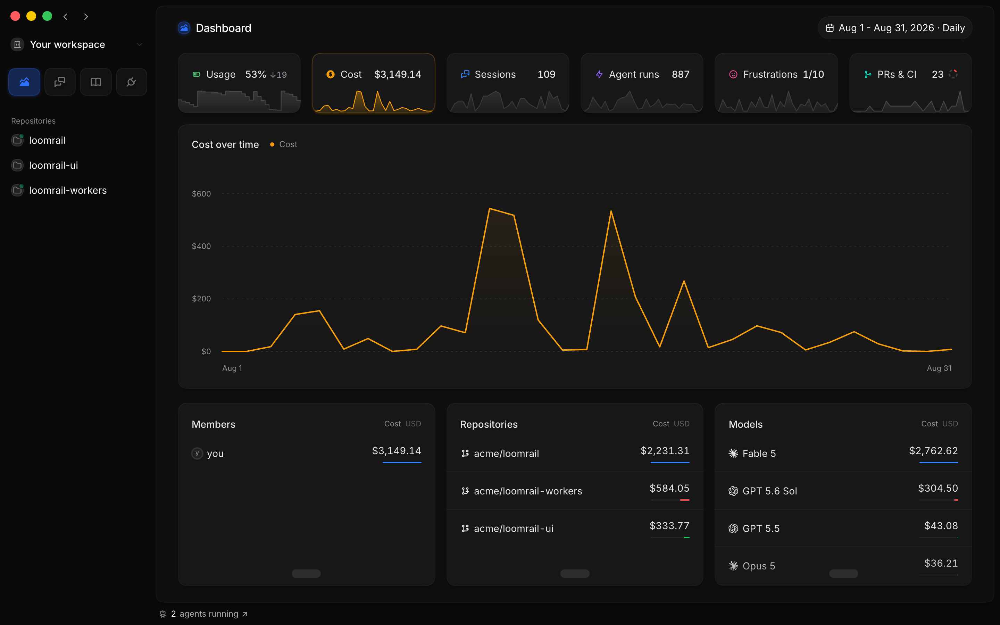
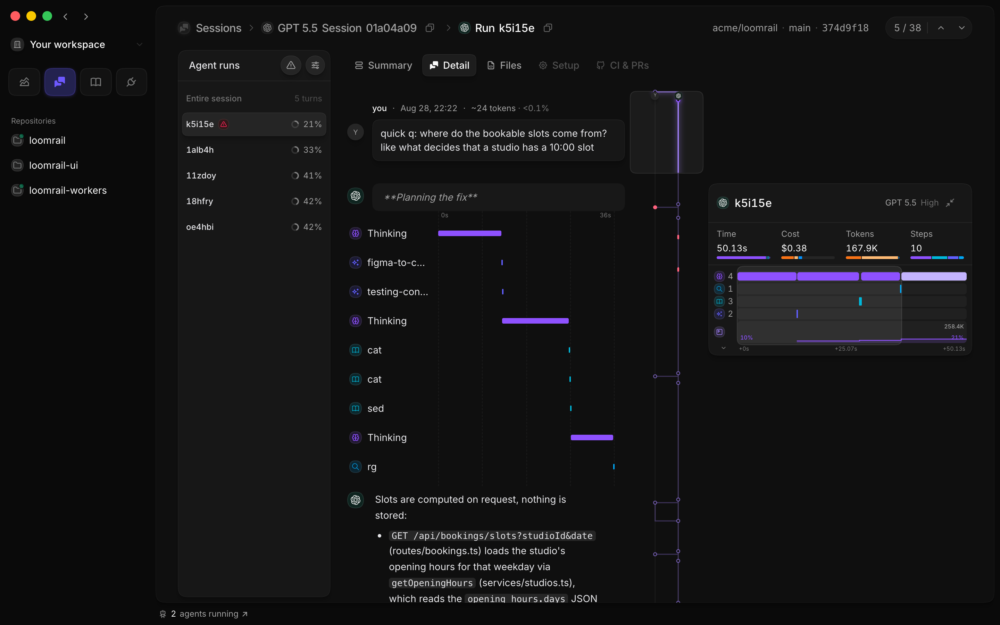

<div align="center">

# Opaline

**See where your Claude Code and Codex agents get stuck, what they cost, and what to fix in your setup.**

[-black?logo=apple)](https://github.com/evrendom/opaline/releases/download/desktop-latest/Opaline-macOS-arm64.dmg)
[-black?logo=apple)](https://github.com/evrendom/opaline/releases/download/desktop-latest/Opaline-macOS-x64.dmg)
[](https://github.com/evrendom/opaline/releases)
[](LICENSE)

**Download Opaline for Mac:** [**Apple Silicon**](https://github.com/evrendom/opaline/releases/download/desktop-latest/Opaline-macOS-arm64.dmg) · [**Intel**](https://github.com/evrendom/opaline/releases/download/desktop-latest/Opaline-macOS-x64.dmg) · [opaline.so](https://opaline.so)

</div>

<p align="center">
  <a href="docs/assets/readme/dashboard.mp4">
    
  </a>
</p>

Opaline is a local-first Mac app for **Claude Code** and **Codex**. It reads the sessions your coding agents already leave on your Mac and shows what they cost, where they loop or fail, which mistakes keep coming back, and what to improve in your `CLAUDE.md`, `AGENTS.md`, skills, hooks, scripts, or CI.

Everything runs on your machine. Opaline brings its own local server, Postgres, and ClickHouse—nothing leaves your Mac.

---

## What you get

- **Usage & cost breakdowns** — Track Claude Code and Codex spend and usage by day, repository, and model, including your plan usage.
- **Readable session inspector** — Inspect every turn, tool call, touched file, context window, subagent, pull request, and CI run without digging through raw transcripts.
- **Loop & failure flags** — Automatically surface runs that looped, failed, or needed correction so recurring setup problems stand out immediately.
- **Built-in MCP for your agents** — Click **"Connect your agents"** to install the Opaline plugin in Claude Code and Codex so your agents can query past sessions directly through the local MCP server.
- **Zero-config local stack** — Bundles its own server, Postgres, and ClickHouse, and keeps itself up to date from GitHub Releases.

<table>
  <tr>
    <td width="50%"></td>
    <td width="50%"></td>
  </tr>
  <tr>
    <td align="center"><sub><b>Cost</b> by day, repository and model</sub></td>
    <td align="center"><sub><b>Frustrations</b>: corrections and apologies, with the exact words</sub></td>
  </tr>
  <tr>
    <td width="50%"></td>
    <td width="50%"></td>
  </tr>
  <tr>
    <td align="center"><sub><b>Sessions</b> with cost, skills, errors and feedback</sub></td>
    <td align="center"><sub><b>Session summary</b>: what filled the context window</sub></td>
  </tr>
</table>

<p align="center">
  
  <br />
  <sub><b>Session detail</b>: every turn and tool call on one timeline</sub>
</p>

---

## Quick Start

1. Download Opaline for Mac ([**Apple Silicon**](https://github.com/evrendom/opaline/releases/download/desktop-latest/Opaline-macOS-arm64.dmg) or [**Intel**](https://github.com/evrendom/opaline/releases/download/desktop-latest/Opaline-macOS-x64.dmg)) and move it to Applications.
2. Launch Opaline—it automatically starts its bundled local stack and reads your existing Claude Code and Codex sessions.
3. *(Optional)* Click **"Connect your agents"** inside the app to enable the local MCP plugin for Claude Code and Codex.

---

## Privacy

Agent transcripts contain whatever your agents saw: source code, prompts, command output, file contents, URLs, and sometimes secrets. Opaline processes and stores everything locally on your Mac—no telemetry, no cloud sync, and no external database required.

---

## Build from Source

**Requirements:** macOS and [Bun](https://bun.sh).

```bash
git clone https://github.com/evrendom/opaline.git
cd opaline
bun install
bash apps/desktop/shell/package.sh
```
