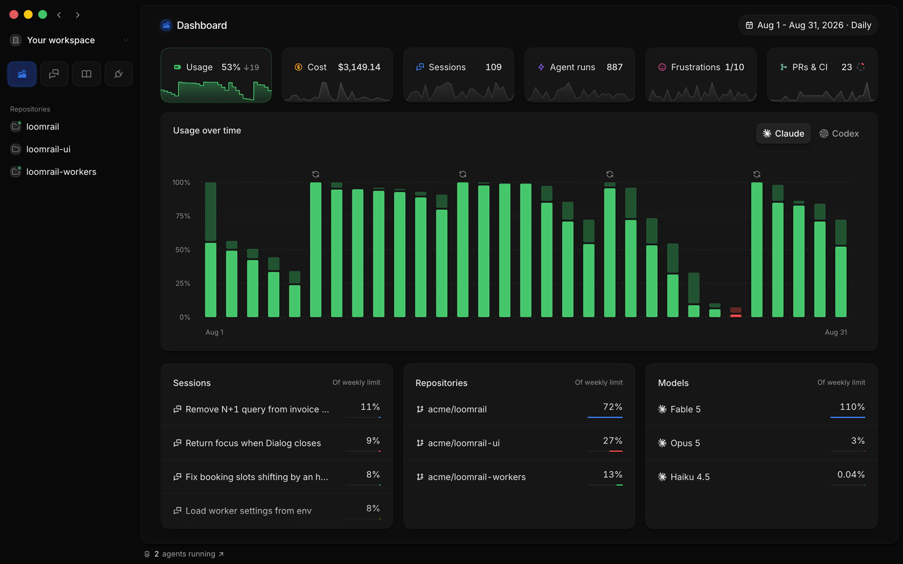
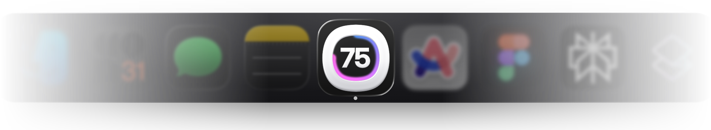
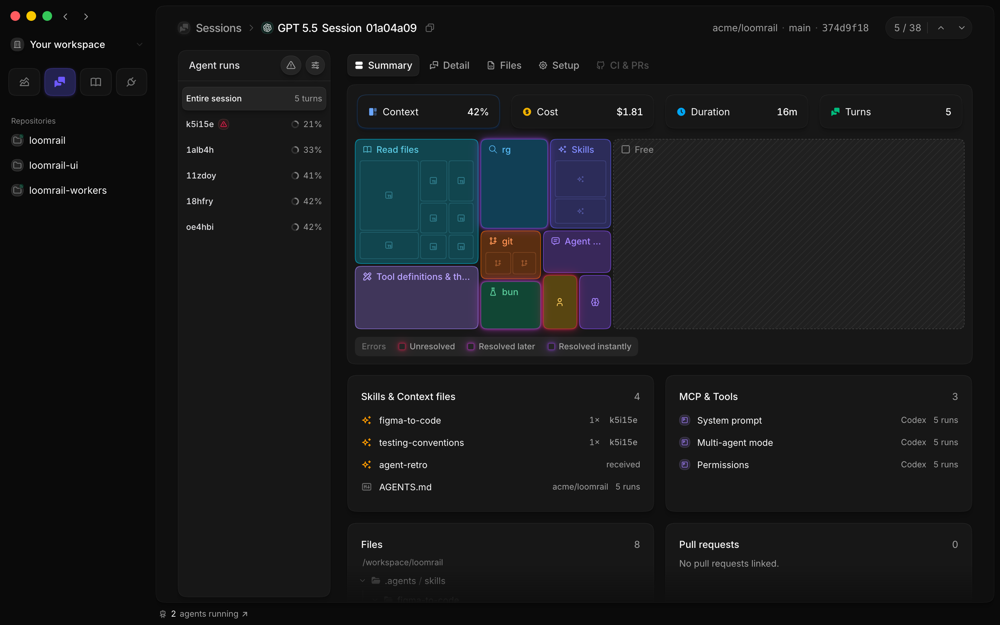
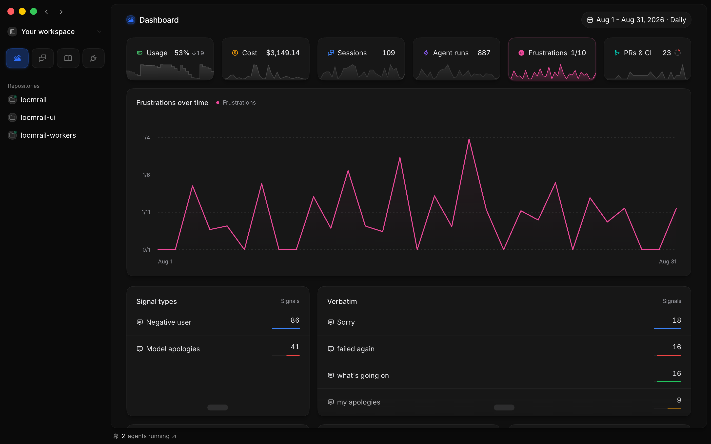
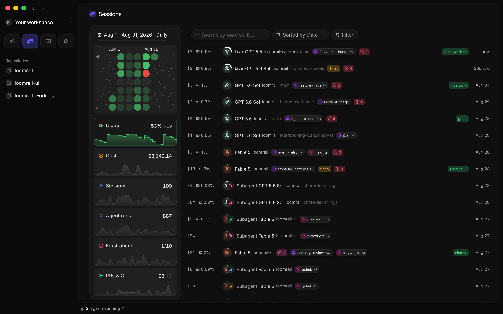
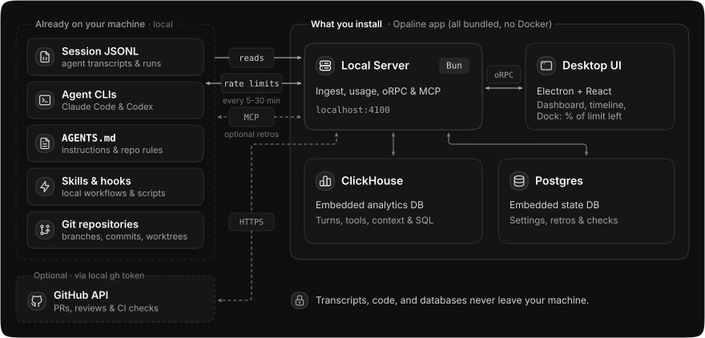

<div align="center">


# Opaline

**Pull back the curtain on your Claude Code and Codex sessions.**

Local-first desktop app for macOS and Linux. See what filled your context window, where agents got stuck, what they cost, and let them retro their own setup.

<p align="center">
  <a href="https://github.com/evrendom/opaline/releases"></a>
  <a href="https://www.producthunt.com/products/rudel/launches/claude-code-codex-usage-trading-cards-by-rudel" title="Product Hunt #5 with 172 upvotes (May 4, 2026)"></a>
  <a href="https://news.ycombinator.com/item?id=47350416" title="Show HN: 144 points and 86 comments"></a>
  <a href="LICENSE"></a>
</p>

[Install](#install) · [Features](#features) · [Agent MCP](#let-your-agents-retro-themselves) · [Architecture](#how-its-built) · [Build from source](#build-from-source) · [opaline.evren.so](https://opaline.evren.so)

</div>

<p align="center">
  
</p>

## Install

- **macOS:** [Apple Silicon (`.dmg`)](https://github.com/evrendom/opaline/releases/download/desktop-latest/Opaline-macOS-arm64.dmg) · [Intel (`.dmg`)](https://github.com/evrendom/opaline/releases/download/desktop-latest/Opaline-macOS-x64.dmg) (open and drag to Applications)
- **Linux x64:** [AppImage](https://github.com/evrendom/opaline/releases/download/desktop-latest/Opaline-Linux-x86_64.AppImage) (`chmod +x` and run) · [`.deb`](https://github.com/evrendom/opaline/releases/download/desktop-latest/Opaline-Linux-amd64.deb) (`sudo apt install ./Opaline-Linux-amd64.deb`)

Launch Opaline and it starts its bundled local stack automatically, imports existing Claude Code and Codex sessions, and updates via GitHub Releases. No account, no Docker, and nothing leaves your machine. *(Downloads are ~310-530 MB because Electron, Postgres, and ClickHouse are bundled in.)*

<p align="center">
  
</p>

On macOS, the Dock icon shows how much of your weekly Claude Code or Codex limit is left. Right-click it for each agent's number, its reset time, and which one the icon shows.

## Features

See what actually consumed your context window (`Read files`, `rg`, skills, tool definitions, shell output) and which tool calls failed, recovered, or stayed unresolved:



| Surface | What it gives you |
| :--- | :--- |
| **Session timeline** | Every turn, thinking block, skill, file read, subagent, and step-by-step cost without reading raw JSONL. |
| **Frustrations** | Verbatim user corrections and model apologies (`"Sorry"`, `"failed again"`) tracked over time. |
| **Usage & cost** | Weekly Claude and Codex plan-limit burn, estimated API cost by repo and model, and live running agents. |
| **Built-in MCP** | One-click plugin so your agents can query past runs and propose fixes to `CLAUDE.md`, `AGENTS.md`, skills, or CI. |

<details>
<summary>More screenshots (timeline, frustrations, sessions, cost)</summary>

<br />

**Session timeline:** every turn and tool call in one view


**Frustrations:** corrections and apologies with exact verbatim phrases


**Sessions:** live agents, subagents, skills, errors, and cost per session


**Cost:** spend over time by repository and model


</details>

## Let your agents retro themselves

Click **Connect your agents** inside Opaline to install the local skill and MCP server for Claude Code and Codex. Then ask them directly:

```text
"Run a retro on my last 30 days: where did my agents lose the most time, and what should I change in CLAUDE.md?"
"Why did my last run in acme/loomrail cost $19 and loop on tests?"
"Compare my Claude Code and Codex runs this month by cost and frustration rate."
```

The MCP server gives your agents read-only SQL, pattern digests, search, and saved checks so they can pinpoint recurring failures, edit your repo setup, and verify whether a fix held.

## How it's built

Everything runs inside one local bundle. There is no cloud service, no telemetry, and no external database.

<p align="center">
  <picture>
    <source media="(prefers-color-scheme: dark)" srcset="docs/assets/readme/architecture-dark.svg" />
    <source media="(prefers-color-scheme: light)" srcset="docs/assets/readme/architecture-light.svg" />
    
  </picture>
</p>

- **Code layout:** `apps/desktop/shell` (Electron + runtime manager), `apps/desktop/ui` (React + Vite), `apps/desktop/server` (Bun + oRPC + MCP), `packages/ch-schema` & `packages/sql-schema` (database schemas), `plugin/` (agent skill).
- **Local data:** Stored under `~/Library/Application Support/Opaline/server` on macOS or `~/.config/Opaline/server` on Linux.
- **Privacy:** Transcripts may include source code, prompts, command output, and secrets. Opaline never sends them off your machine.

## Build from source

Requires [Bun](https://bun.sh) (plus Docker for `dev:local`).

```bash
git clone https://github.com/evrendom/opaline.git
cd opaline
bun install

# Local development (starts Postgres + ClickHouse in Docker, then API + UI)
bun run dev:local

# Package the desktop app
bash apps/desktop/shell/package.sh        # macOS (.app + .dmg)
bash apps/desktop/shell/package-linux.sh  # Linux x64 (.AppImage + .deb)

# Full check suite (disclosure, typecheck, lint, tests, build)
bun run verify
```

## License

[Apache-2.0](LICENSE)
